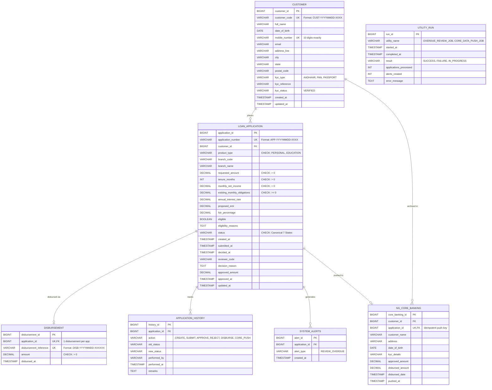

# Entity-Relationship (ER) Diagram & Schema Specification
## Database: `newgen_loan_origination` (MySQL 8.x)

---

### 1. Conceptual Entity Relationship Model

---

### 2. Table Specifications & Constraint Details

#### 1. `CUSTOMER`
| Column Name | Data Type | Modifiers | Description |
| :--- | :--- | :--- | :--- |
| `customer_id` | `BIGINT` | `PK, AUTO_INCREMENT` | Surrogate primary key |
| `customer_code`| `VARCHAR(30)` | `NOT NULL, UNIQUE` | Unique reference code |
| `full_name` | `VARCHAR(100)`| `NOT NULL` | Full applicant name |
| `date_of_birth`| `DATE` | `NOT NULL` | DOB (Age $21-60$ verified at submission) |
| `mobile_number`| `VARCHAR(15)` | `NOT NULL, UNIQUE` | 10-digit unique mobile |
| `email` | `VARCHAR(100)`| `NULL` | Contact email |
| `address_line` | `VARCHAR(255)`| `NOT NULL` | Street address for Core Banking push |
| `city` | `VARCHAR(50)` | `NOT NULL` | City |
| `state` | `VARCHAR(50)` | `NOT NULL` | State |
| `postal_code` | `VARCHAR(20)` | `NOT NULL` | PIN code |
| `kyc_type` | `VARCHAR(30)` | `NOT NULL` | Aadhaar, PAN, Passport |
| `kyc_reference`| `VARCHAR(50)` | `NOT NULL` | KYC identification number |
| `kyc_status` | `VARCHAR(20)` | `NOT NULL, DEFAULT 'VERIFIED'` | Verification status |

#### 2. `LOAN_APPLICATION`
- **Foreign Key**: `customer_id` references `CUSTOMER(customer_id)`.
- **Unique Constraint**: `application_number` (`APP-YYYYMMDD-XXXX`).
- **Check Constraints**:
  - `status IN ('DRAFT', 'UNDER_REVIEW', 'CREDIT_APPROVAL', 'REJECTED', 'DISBURSED', 'CORE_BANKING_PUSH', 'EXIT')`
  - `product_type IN ('PERSONAL', 'EDUCATION')`
  - `requested_amount > 0`
  - `tenure_months > 0`
  - `monthly_net_income > 0`
  - `existing_monthly_obligations >= 0`
- **Indexes**:
  - `idx_loan_app_active_check (customer_id, product_type, status)`: Accelerates active application concurrency control.
  - `idx_loan_app_review_ageing (status, submitted_at)`: Optimizes overdue review identification.

#### 3. `DISBURSEMENT`
- **Foreign Key**: `application_id` references `LOAN_APPLICATION(application_id)`.
- **Unique Constraint 1**: `application_id` (`UNIQUE`) — Guarantees exactly one disbursement per loan.
- **Unique Constraint 2**: `disbursement_reference` (`UNIQUE`) — Prevents duplicate transaction references.

#### 4. `SYSTEM_ALERTS`
- **Composite Unique Key**: `uk_app_alert (application_id, alert_type)` — Guarantees that multiple utility runs never produce duplicate alerts for the same loan case.

#### 5. `NG_CORE_BANKING`
- **Unique Key**: `application_id` (`UNIQUE`) — Enforces strict idempotency during core banking sync.
